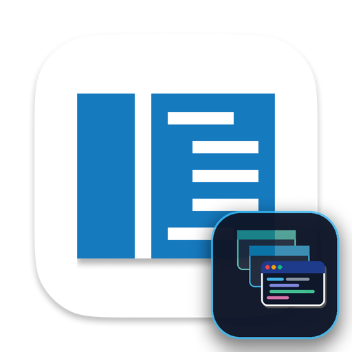
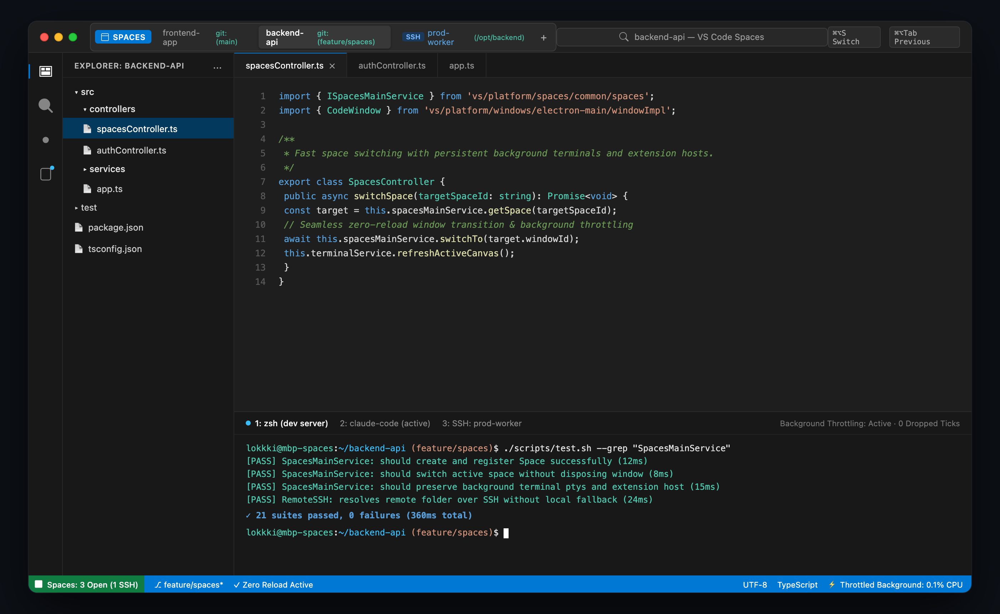
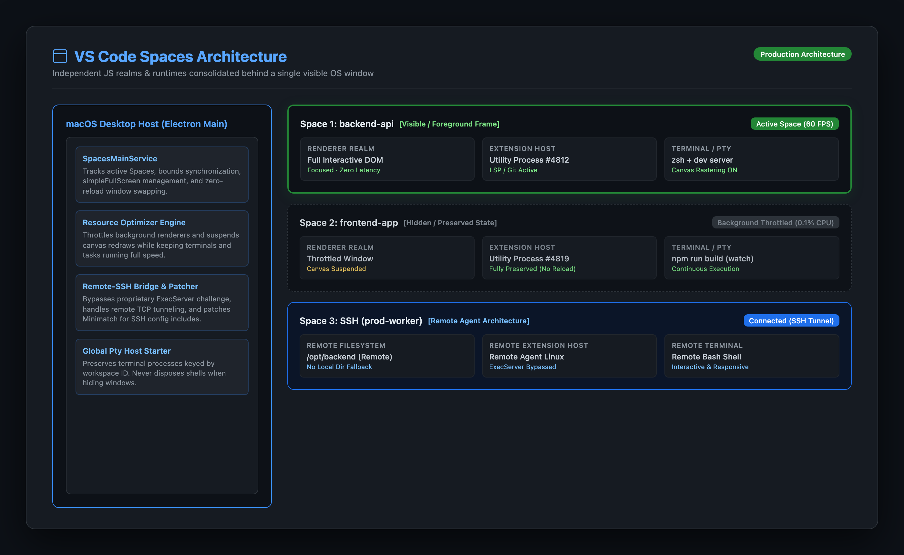

# VS Code Spaces

<p align="center">
  
</p>

<p align="center">
  <strong>Multiple full workspaces in a single OS window.</strong><br>
  Zero workspace reloading. Zero state loss. Background resource throttling. Native SSH Spaces.
</p>

<p align="center">
  <a href="#key-features">Features</a> •
  <a href="#architecture">Architecture</a> •
  <a href="#quick-start--installation">Quick Start</a> •
  <a href="#keyboard-shortcuts">Shortcuts</a> •
  <a href="#ssh-spaces--remote-development">SSH Spaces</a> •
  <a href="#settings">Settings</a>
</p>

<p align="center">
  
  
  
  
</p>

---

## Overview

<p align="center">
  
</p>

Traditional editor workflows force a frustrating compromise:
1. **Window sprawl**: Spreading 10 open workspaces across separate OS windows clutters Mission Control, Dock, and Task Switchers.
2. **State destruction**: Opening a new folder in the same window destroys the active JavaScript realm, tearing down terminal ptys, killing active build watchers, and abruptly terminating long-running background AI sessions (e.g. Claude Code or autonomous agent tasks).

**VS Code Spaces** solves this problem. It consolidates independent, fully-featured workspaces ("Spaces") behind a **single visible OS window frame**. Switching between Spaces is instantaneous, keeping every extension host, background task, dirty editor, and terminal session alive and running without interruption.

---

## Key Features

- **Single OS Window Frame**: Keep your desktop clean. Switch between multiple active projects through the integrated Spaces title bar, Quick Pick switcher, or keyboard shortcuts.
- **Instant Space Switching (Zero Reload)**: Switching Spaces never reloads the window or unloads the workspace. Editor state, undo history, scroll positions, and view layouts are preserved exactly as you left them.
- **Persistent Terminals & Background Tasks**: Compilers (`tsc -w`, `npm run dev`), Docker logs, test runners, and Claude Code sessions run continuously in the background without dropping a single tick.
- **Resource Optimization Engine**: Background Spaces are dynamically throttled. Chromium canvas redraws are suspended and CPU usage drops to near zero (~0.1%), maximizing battery efficiency and system responsiveness.
- **First-Class SSH Spaces**: Open and browse remote servers directly over SSH. Features automated ExecServer bypassing for Code OSS compatibility, SSH config wildcard support, and instant terminal canvas raster refresh.
- **Space Metadata & Git Branch Display**: Space pills in the title bar show real-time Git branch names (`git:(feature/auth)`), remote indicators, and dirty state counters.
- **Native macOS Application Bundle**: Ships with custom high-resolution application branding (`CodeSpaces.icns`), `/Applications/VS Code Spaces.app`, and a command-line launcher (`code-spaces`).

---

## Architecture

<p align="center">
  
</p>

### How Spaces Work Under the Hood

In VS Code's standard desktop architecture, each `CodeWindow` binds a single `BrowserWindow` to an independent renderer process, an extension host utility process, and workspace storage (`state.vscdb`).

VS Code Spaces orchestrates these processes through `SpacesMainService`:

1. **Process Independence**: Every Space maintains its own complete JavaScript realm, extension host utility process, and storage database. Extension singletons and language servers never collide.
2. **Single-Frame Window Swapping**: When you switch Spaces, `SpacesMainService` synchronizes geometry, smooths macOS window transitions via `simpleFullScreen` and `safeHideWindow`, and swaps visibility without triggering `UnloadReason.LOAD`.
3. **Pty Host Persistence**: Terminal ptys are registered with the global Pty Host and bound by workspace ID. When a window is hidden, its terminal connections detach safely rather than being disposed, allowing commands to stream uninterrupted into xterm circular buffers.
4. **Canvas Raster Synchronization**: On returning to a Space, `SpacesContribution` triggers `xterm.raw.refresh()` to immediately paint buffered output without blank/black canvas throttling artifacts.

For deep technical design notes, see [Spaces Architecture Notes](docs/spaces-architecture-notes.md).

---

## Quick Start & Installation

### Option 1: Install macOS App Bundle (Recommended)

To compile and install **VS Code Spaces.app** into `/Applications` and register the `code-spaces` CLI:

```bash
./scripts/install-mac-app.sh
```

Once installed, launch it directly from Spotlight or your terminal:

```bash
code-spaces ~/my-project
```

### Option 2: Run From Sources (Developer Mode)

1. **Clone and install dependencies**:
   ```bash
   git clone https://github.com/Lokknath/vscode-spaces.git
   cd vscode-spaces
   npm install
   ```

2. **Transpile client core**:
   ```bash
   npm run transpile-client
   ```

3. **Launch Code Spaces**:
   ```bash
   ./code-spaces <path-to-folder>
   ```

---

## Keyboard Shortcuts

| Keybinding | Action | Command ID |
|---|---|---|
| <kbd>⌘</kbd> <kbd>⌥</kbd> <kbd>S</kbd> | Open Spaces Quick Pick Switcher | `workbench.action.spaces.switch` |
| <kbd>⌘</kbd> <kbd>⌥</kbd> <kbd>Tab</kbd> | Toggle to Previous Active Space | `workbench.action.spaces.togglePrevious` |
| <kbd>⌘</kbd> <kbd>⌥</kbd> <kbd>N</kbd> | Create / Open New Space | `workbench.action.spaces.new` |
| <kbd>⌘</kbd> <kbd>⇧</kbd> <kbd>P</kbd> | Close Inactive Background Spaces | `workbench.action.spaces.closeInactive` |

*(On Linux and Windows, use <kbd>Ctrl</kbd> + <kbd>Alt</kbd>)*

---

## SSH Spaces & Remote Development

VS Code Spaces includes comprehensive support for remote SSH workflows without requiring proprietary Microsoft signing binaries.

<p align="center">
  
</p>

### Connecting to an SSH Host

Open a remote host directly from the CLI:
```bash
code-spaces --remote ssh-remote+prod-server /var/www/application
```

Or from within the editor:
1. Press <kbd>⌘</kbd> <kbd>⇧</kbd> <kbd>P</kbd>
2. Run **Remote-SSH: Connect to Host...**
3. Select your remote SSH target. It opens as a new Space in your existing window frame!

### Built-in Remote Fixes
- **VSDA ExecServer Bypass**: Eliminates `CodeError(ServerAuthRequired)` by utilizing standard SSH port forwarding and connection token authentication.
- **SSH Config Wildcard Support**: Patches extension Minimatch exports to correctly parse `Include /etc/ssh/ssh_config.d/*`.
- **Zero Blank Terminals**: Forces immediate canvas redraw upon switching between local and remote spaces.

Read the full [SSH Spaces Guide](docs/ssh-spaces-guide.md) for details.

---

## Settings Reference

VS Code Spaces can be customized via your `settings.json`:

```json
{
  "workbench.experimental.spaces.enabled": true,
  "workbench.experimental.spaces.resourceOptimization": true,
  "workbench.experimental.spaces.autoAdoptWindows": true,
  "workbench.experimental.spaces.restoreOnStartup": true,
  "workbench.experimental.spaces.focusEditorOnSwitch": true,
  "workbench.experimental.spaces.refreshTerminalsOnSwitch": true,
  "window.nativeFullScreen": false,
  "window.titleBarStyle": "custom",
  "remote.SSH.useExecServer": false
}
```

---

## Verification & Automated Testing

VS Code Spaces includes automated test suites covering lifecycle, state preservation, and user flows:

- **Spaces Unit Tests**:
  ```bash
  ./scripts/test.sh --grep "SpacesMainService"
  ```
- **Typecheck & Client Validation**:
  ```bash
  npm run typecheck-client
  ```
- **End-to-End User Verification**:
  ```bash
  ./test/spaces/test-like-user.sh
  ```

---

## Contributing

We welcome contributions! Please review the [Coding Guidelines](.github/copilot-instructions.md) before submitting pull requests.

## License

This project is licensed under the [MIT License](LICENSE.txt).
Visual Studio Code and Code - OSS are trademarks of Microsoft Corporation.
